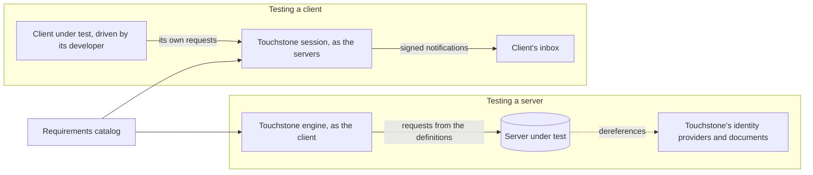

# Methodology
{: .no_toc }

Touchstone tests both sides of the LWS protocol. It tests a server by playing the client, and a
client by playing the servers. The roles reverse, but the method does not: the same catalog, the
same kind of definition, the same discipline for proving that a test can fail, and the same
verdict. This page explains that method: what Touchstone counts as evidence, how a test earns its
place, and what a result does and does not claim.

For the mechanics, see [How it works](how-it-works.md), for a server run, and
[Testing a client](testing-a-client.md), for the client service.

1. TOC
{:toc}

## Principles

These hold on both sides.

- **The specification's text is the yardstick.** Every normative clause of the drafts is a
  requirement in the [catalog](catalog.md), with a stable IRI, the dated draft it came from, and a
  hash of its exact words. Every test cites the requirements it verifies, and a failure always
  cites a clause. Touchstone's own advice, such as a client rule's guidance, never decides an
  outcome.
- **Who a clause binds decides who is tested on it.** Each requirement names the roles that can
  break it: server, authorization server, client, identity provider or webhook inbox. Server runs
  answer for the server and authorization server requirements, and client sessions for the client
  and inbox ones. A test must cite a requirement its side can break, and the lint refuses one that
  does not.
- **Tests are data.** Server tests and client rules are both [YAML-LD definitions](definitions.md),
  checked by one schema and one lint. Each side has a frozen contract that says exactly what every
  key means:
  [`EXECUTION.md`]() for server tests and
  [`OBSERVATION.md`]() for client rules.
  Everything a test asserts is in its definition. The engine adds no assertion and softens none.
- **Touchstone owns the other parties.** It implements the counterparties itself, rather than
  borrowing a real implementation: identity providers for server runs, and a storage with its
  authorization server for client sessions. That is the only way to produce wrong behaviour on
  purpose, and it keeps every implementation out of the yardstick. Touchstone grades the servers,
  so no server's behaviour can define what a client should expect.
- **The drafts' latitude, not one implementation's habits.** A server test discovers every URL it
  uses rather than assuming one server's layout. A client session behaves in every way the drafts
  allow, including the ways a client is least likely to expect. Either way, a test that relies on
  something the drafts leave open is a defect in the test.
- **Every test is shown to fail.** A test that passes against a correct implementation proves
  little until it has also failed against a wrong one. Each side has a reference implementation
  that every test must pass, and broken twins that each test must catch (see
  [Proving the tests](#proving-the-tests)).
- **One level per test, and only MUST decides.** A SHOULD or MAY check never sits inside a MUST
  test, so a missing optional header cannot make an implementation non-conformant. SHOULD failures
  are warnings, and MAY results are information.
- **Missing evidence is never a pass.** A test that could not run, or could not decide, says so:
  *inapplicable*, *cantTell* or *untested*. None of them counts as passed, and the reports count
  them separately.
- **People decide what enters.** No requirement enters the catalog, and no test enters the suite,
  without a person's review. An agent may draft a test, but the draft goes through the checks, a
  run against the reference, and a pull request. The mapping from tests to requirements is what
  every report rests on.

## Testing a server

Touchstone acts as the client. Each test sends the requests its definition describes and checks
each response against declarative expectations: status codes, headers, links, challenges, JSON
and JWTs.

### Discover, never assume

A server test starts from what a client knows and follows what the server says. The base URL comes
from the storage description when a target is registered by its storage. Created resources come
from `Location`, linksets from `rel="linkset"`, the storage from its `Link`, and the authorization
server from the `401` challenge. The drafts define no path conventions, so a test that guessed one
would test one server's convention, not the specification.

### Isolation

- No test depends on another, or reads anything another created.
- Each test works in a container of its own, inside a container made for the run, so tests can run
  in parallel without colliding.
- Each test deletes what it created. Cleanup never changes an outcome.

### Separating setup from findings

A test declares what it needs but does not examine: the resources in `prereqs`, and the access to
grant on them. The engine creates them before the first step. A failed prerequisite is not a
finding about the server, so it ends the test *cantTell*. A resource is created in a step only
when creation is what the test examines.

In the same way, a step marked as a precondition checks that the server offers what the test
needs. When it does not, the test is *inapplicable*, not *failed*. Only a failed expectation in an
ordinary step is a finding.

### Negative tests

To check that a server refuses bad credentials, Touchstone needs bad credentials, and real identity
providers will not issue them on purpose. So Touchstone runs its own: it mints access tokens, CID
credentials, ID Tokens and SAML assertions, and each fault identity is a valid credential with
exactly one defect, such as an expired token or a wrong audience. A negative test then proves the
refusal: after the `4xx`, it checks that the refused request had no effect.

See [Authentication suites](auth.md).

### Optional features

An optional feature never fails a server. A feature the server can reveal, such as an access grant
service, is discovered, and the tests that need it are inapplicable when it is absent. What a server
cannot reveal about itself, such as whether it trusts Touchstone's SAML identity provider, the
target declares as a capability. A test that needs a capability the target lacks is inapplicable
before it sends a request.

### No retries

A server that fails now and then has a real defect, and Touchstone reports it as one. The only
exception is a server that says it is limiting requests or briefly unavailable: a `429` or `503`
with a short `Retry-After` is waited out a few times. One that waiting does not get past ends the
test *cantTell*, since the server never answered the request.

## Testing a client

Touchstone plays everything a client talks to: the storage, its authorization server, an OpenID
Provider, a SAML identity provider, the hosts of identity documents, and the notification service
that calls the client's inbox. Each session gets servers of its own.

### The developer drives, Touchstone observes

Touchstone never drives the client. It has no adapters and no per-language bindings. The developer
uses the client as they normally would, by hand or from its own test suite, and every request
reaches a real server that answers it for real. Touchstone records each exchange and judges it.
The only interface is HTTP, which every LWS client already speaks.

### Facts only the server knows

Many client obligations can only be judged with knowledge a server has and a request does not
show. Was this URL handed out, or did the client build it? Did this resource advertise the method
the client is using? So the session's recorder attaches *annotations* to every exchange:

- what the request addressed, as the server sees it: a container, a page, a linkset, the token
  endpoint, and so on;
- where the request carried a credential: the `Authorization` header, the query string, a form
  body or another header;
- whether the URL was **issued**: the session keeps a ledger of every URL it handed out, in
  `Location`, `Link` targets, listings and documents. A request for a URL that is not in it is a
  URL the client built itself, and the recorder names the issued URL it was built from;
- what the target last advertised in `Allow`, `Accept-Patch` and `Accept-Query`;
- whether the request repeats the last one to the same URL unchanged;
- for a token request, where its credential came from and what it claims;
- whether a fault fired on the exchange.

Annotations are computed from the session's state before the exchange, so an answer never vouches
for its own request. All the cleverness lives in the recorder, which is tested once, so the rules
stay declarative.

### Rules and trials

A client rule has two conditions. `observe` selects the exchanges it judges, its *trials*, and
`expect` states what must hold of each. Some rules judge "the next X after Y", for example the
next request after a refused one. Rules have no variables and pass nothing between trials, and a
rule's level may be no stronger than the strongest of the requirements it cites.

A trial passes when every term of `expect` holds. Otherwise it fails, and the evidence is the
first term that failed: what it expected, and what the client sent.

### Intent and tasks

Some obligations depend on what the client meant to do. A POST without `Link: rel="type"` creates
a data resource, which is legal unless the client meant to create a container. For such rules the
developer starts a **task** first, saying what they are about to do, and the rule judges the next
matching request. A rule that needs intent is never tried until its task starts.

### Traps and faults

A client that follows the specification must cope with everything the drafts allow a server to do,
not only with what most servers do. The session's storage therefore sets **traps**, legal behaviour
that a client relying on unspecified behaviour trips over: opaque page URLs, resource URLs that do
not nest under their container's, binary resources that refuse PUT, a decoy that links its
challenge to a storage on another origin, and an index that lags behind writes. A conformant client
never notices them.

Some behaviour is legal but rare: a refused method, a lost response, an expired page, an expired
token. A task can arm a **fault**, which makes the session answer one request that way. Rules do
not name faults. They judge the client's response to the answer a fault produces, so a server that
gives the same answer for reasons of its own triggers the same rule.

Four forgery faults go further: they sign the next notification wrongly, as an attacker would, and
the client's inbox must refuse it.

### What cannot be judged

Some client obligations never show in a request. A client must not assume that search shows a
write at once, but a client that mishandles stale results does so internally. Such obligations get
no rule, and [`COVERAGE.md`]() gives the
reason for each client requirement that no rule judges.

### Coverage is what the client exercised

A session judges only what the client did. A rule the client never triggered is *untested*, which
is coverage the session did not have, not evidence either way. So the verdict reads, for example,
"no MUST failure in 12 MUST rules exercised, of 30 that apply", and never plain "conformant". The
checklist of tasks makes every rule reachable on purpose, and the client's own test suite can drive
a session from CI to make that coverage repeatable.

### Against a real server

The session's own storage proves a client handles everything the drafts allow. To see how it gets on
with one particular server, a session can instead put a real server behind a recording proxy. The
recorder then infers what each URL is from what the server handed out, and the proxy injects the
faults it can. The rules that need what only the session's own servers know, such as a
credential's claims or a notification's signature, are inapplicable there.

A conformant client meeting a server's quirk is a finding about one of the two, so proxy mode also
cross-checks the servers.

## Proving the tests

`./mvnw verify` runs both suites against implementations whose behaviour is known.

**Server tests.** `DefinitionsSelfTest` runs every definition against Touchstone's reference
server and authorization server, and against their broken twins:

- against the reference deployment, every test passes or is inapplicable for a reason the
  deployment explains;
- against the same deployment with every trap set, the same holds, so no test assumes something the
  drafts leave open;
- against each broken twin, such as an authorization server that accepts any credential or a
  storage that never refuses access, exactly the tests that exist to catch that defect fail.

A new test must pass against the reference deployment. If nothing can pass it, the reference server
is extended first, since a test that nothing passes proves nothing.

**Client rules.** `ClientRulesSelfTest` runs `RefLwsClient`, a scripted client that does what the
rules ask and starts every task, in a session of its own. It passes every rule. Each of its broken
twins gets one thing wrong, such as building a page URL or sending its token in the query string,
and fails exactly the rules aimed at it and nothing else. Every rule has a twin aimed at it, since a
rule that no twin fails could never fail. `ProxyRulesSelfTest` repeats this through the proxy, for
the rules a proxy session can judge.

**Real implementations.** Beyond the reference, Touchstone is run against every known LWS server
implementation, each built from source (see
[Every known LWS server](getting-started.md#every-known-lws-server)). When a server fails a test,
the drafts decide which of the two is wrong, and sometimes it is the test. lws-drupal once failed a
type search test that expected a PUT to change a resource's type. The core draft says a PUT changes
only the content unless the client asks for a combined update, so the test now asks, and a server
that does no combined updates finds it inapplicable (D-0089). Each such finding, and how it was
settled, is recorded in [`DECISIONS.md`]().

## Keeping up with the draft

LWS is a Working Draft and changes often. Each catalog entry records the dated draft it came from,
and every draft snapshot is archived unchanged, so every clause hash can be recomputed. A test cites
a requirement only while its clause still holds in the snapshot the test names as its source. A
weekly check fetches the latest published drafts and fails when W3C has published a newer one or a
catalogued clause has changed, so a moved specification shows up as a failing check, not as tests
that have silently gone stale. Moving the catalog to a new draft is itself a reviewed change, and
the tests that cite the affected requirements are reviewed with it. See
[Tracking the draft](catalog.md#tracking-the-draft).

## What a result claims

- **A server verdict** says that no MUST test failed and none ended *cantTell*, against the dated
  drafts the catalog follows, for the requirements the suite covers, and given the capabilities the
  target declares. The requirement matrix shows every requirement no test covers yet as
  `UNCOVERED`, and `touchstone coverage` gives the current figures. See
  [Reports and verdicts](reports.md).
- **A client verdict** covers only what the client exercised in that session, and says how much
  that was. Touchstone gives client developers feedback, not certification.
- **Both** are reported in W3C [EARL](https://www.w3.org/TR/EARL10-Schema/), with each assertion
  linked to the requirements its test verifies. A server run is `earl:automatic`; a client session
  is `earl:semiAuto`, since a person drives the client and Touchstone judges.
